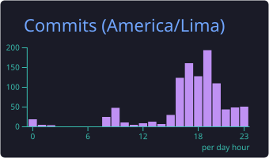
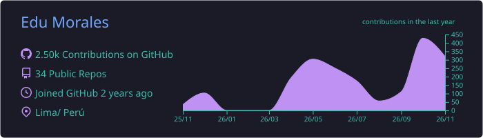

<!--
  Todas las tarjetas de estadísticas se generan automáticamente como SVG estáticos
  mediante GitHub Actions (.github/workflows/update-profile-stats.yml) y se publican
  en la rama `output`, evitando caídas o límites de servidores externos en Vercel.
  Opcional: agrega el secreto `PROFILE_STATS_TOKEN` (PAT) si deseas incluir actividad
  de repositorios privados.
-->

  

### Hola, soy Edu

Ingeniero de software en formación en la [Universidad Tecnológica del Perú](https://www.utp.edu.pe/). Me motiva construir productos útiles, aprender **inteligencia artificial** aplicada y colaborar en proyectos con impacto real.

---

### Stack

#### Front-end

  

#### Back-end, APIs y datos

  

#### Herramientas, entorno y DevOps

  

  

#### Explorando y aprendiendo

  

---

### Actividad en GitHub

  
  

  
  

  

  

---

  

  

